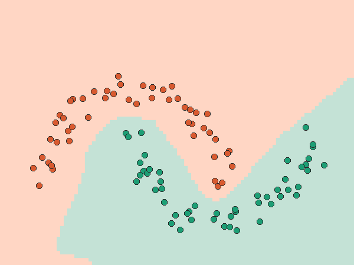

# 02 micrograd：150 行代码看懂反向传播

## 这是什么

[micrograd](https://github.com/karpathy/micrograd) 是 Andrej Karpathy 写的教学项目（MIT 许可证），
用大约 150 行纯 Python 实现了自动求导和一个小神经网络库。
读懂它，就读懂了 PyTorch 里 `loss.backward()` 背后的原理。

本文件夹**不包含** micrograd 的源码，只包含我写的演示脚本。

## 怎么运行

```bash
git clone https://github.com/karpathy/micrograd
python run_demo.py
```

`run_demo.py` 复现了原作者笔记本里的实验：用一个 2→16→16→1 的多层感知机（337 个参数）
把两个交错的"月牙"点集分开。

## 实验结果

100 步训练后，100 个点全部分对（纯 Python 计算，用时约 106 秒）：



背景颜色是网络学到的分界：落在浅橙色区域的点判为橙色类，浅绿色区域判为绿色类。

另一个小实验：只写出机械能公式 E = ½mv² + mgh，调用 `E.backward()`，
micrograd 自动算出 ∂E/∂m = 53.5、∂E/∂v = 6.0（动量 mv）、∂E/∂h = 19.6（重力 mg），和手算一致。

## 必读的代码（约 45 行）

| 文件位置 | 内容 |
|---|---|
| `micrograd/engine.py` 第 5–11 行 | `Value`：记住值、梯度、"我是由谁算出来的" |
| `micrograd/engine.py` 第 24–33 行 | 乘法：前向算结果，同时写好"反向时怎么传梯度" |
| `micrograd/engine.py` 第 54–70 行 | `backward()`：从结果出发，倒着执行每一步的求导 |
| `micrograd/nn.py` 第 20–22 行 | 一个神经元：加权求和 + 激活函数 |

## 我学到了什么

<!-- 用自己的话写 -->

## 打个比方

<!-- 用一个生活中的例子解释梯度下降 -->
