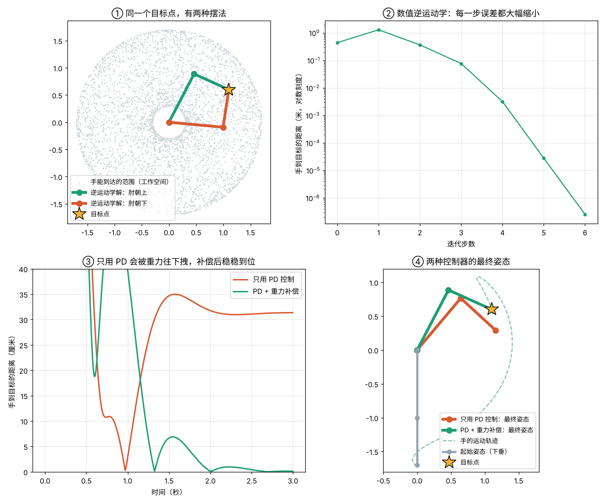
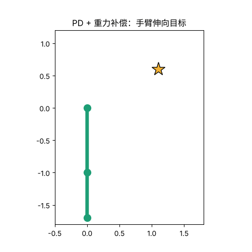

# 04 两节机械臂：运动学、逆运动学和控制

## 这是什么

具身智能的第一步不是"学习"，而是让身体能动。本项目只用 numpy，从零写一条平面两节机械臂：

1. **正运动学**：知道两个关节转了多少度，算出手在哪。
2. **逆运动学**：想让手到某个点，反过来算关节该转多少度。有公式解，也有通用的数值解（雅可比迭代）。
3. **动力学**：用拉格朗日方程写出手臂的运动方程 M(q)·q̈ + C(q, q̇)·q̇ + G(q) = τ，电机出力后手臂怎么转。
4. **控制**：PD 控制器让手臂转到目标姿态；再加上"重力补偿"。

这一个项目不涉及神经网络，但后面的强化学习、模仿学习，学的都是"给电机发什么指令"，底下就是这里的物理。

## 怎么运行

```bash
python arm.py    # 约 10 秒，生成 arm_result.png 和 arm_reach.gif
```

## 文件

| 文件 | 内容 |
|---|---|
| `arm.py` | 正/逆运动学、雅可比矩阵、拉格朗日动力学、RK4 积分、PD 控制和全部实验 |
| `arm_result.png` | 四个实验的结果图 |
| `arm_reach.gif` | 带重力补偿的手臂从下垂伸向目标 |

## 实验结果





| 实验 | 结果 |
|---|---|
| 工作空间 | 臂长 1.0 米和 0.7 米，手能到达离肩 0.3–1.7 米的圆环 |
| 逆运动学（公式解） | 目标点 (1.1, 0.6) 有两组解：肘朝上（62.5°, −86.7°）和肘朝下（−5.3°, 86.7°），误差约 10⁻¹⁶ 米 |
| 逆运动学（数值解） | 7 步收敛到 0.3 微米以内；随机 407 个可达目标，92% 收敛到 0.1 毫米以内，中位数 8 步 |
| 动力学检验 | 关掉电机、去掉摩擦让手臂自由摆 5 秒，总机械能相对偏差 8.5×10⁻⁹，能量守恒，说明运动方程写对了 |
| 只用 PD 控制 | 3 秒后手离目标还有 31.4 厘米：手臂被重力往下拽，PD 要"差一点"才肯出力托住 |
| PD + 重力补偿 | 3 秒后手离目标 1.2 毫米 |

- 同一个点有两种摆法，数值解落到哪一种，取决于从哪个姿态开始迭代。复杂机器人（6、7 个关节）的解有无穷多种，选哪一种本身就是一个问题。
- 数值解没收敛的 8%，多数是目标在工作空间边缘、手臂几乎伸直的情况：这时雅可比矩阵接近不可逆，手往某个方向"使不上劲"，这叫奇异位形。
- PD 控制的稳态误差，和弹簧挂重物会伸长一截是同一个道理：P 项就是一根弹簧，要靠形变才能产生力。重力补偿是先用物理模型算出需要多大力矩来托住手臂，提前加上，PD 只负责"纠偏"。真实的机器人控制器几乎都会做这一步。

## 我学到了什么

<!-- 用自己的话写 -->

## 打个比方

<!-- 例如：雅可比矩阵像什么？重力补偿像什么？ -->
