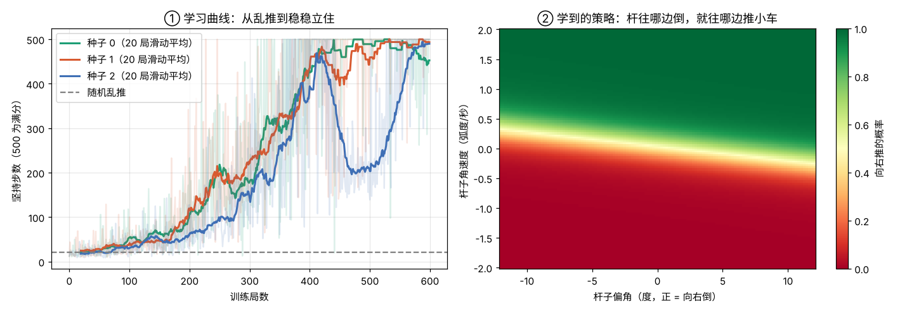
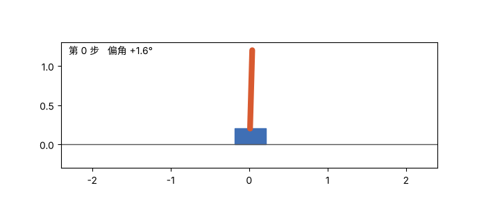

# 05 强化学习入门：从零写策略梯度，让小车立住杆子

## 这是什么

01–03 每个训练样本都有"标准答案"。强化学习没有：智能体只知道"杆子还立着就 +1 分"，要自己摸索出该怎么推小车。

本项目只用 numpy，从零写了两样东西：

1. **环境**：小车立杆（CartPole）的物理方程，和 Gymnasium 的 CartPole-v1 用同一套方程和参数。小车每步只能向左或向右推 10 牛，杆子偏超过 12° 或小车跑出 ±2.4 米就结束。坚持 500 步（10 秒）算满分。
2. **算法**：REINFORCE 策略梯度。策略是一个 4→16→1 的小神经网络，输出"向右推"的概率。每局结束后，得分好的动作加强，得分差的动作削弱。反向传播手写，接着 02 micrograd 的思路。

## 怎么运行

```bash
python cartpole.py    # 用 3 个随机种子各训练 600 局，约 30 秒，生成 cartpole_result.png 和 cartpole.gif
```

## 文件

| 文件 | 内容 |
|---|---|
| `cartpole.py` | 小车立杆物理、策略网络、REINFORCE 训练、测试和画图 |
| `cartpole_result.png` | 学习曲线和学到的策略 |
| `cartpole.gif` | 训练好的策略在控制小车 |

## 实验结果





| | 平均坚持步数 | 满分（500 步）比例 |
|---|---|---|
| 随机乱推 | 21.5 步（0.43 秒） | — |
| 种子 0，训练 600 局后 | 500.0 | 100% |
| 种子 1，训练 600 局后 | 435.6 | 18% |
| 种子 2，训练 600 局后 | 500.0 | 100% |

（测试时每步选概率更大的那个动作，共 100 局，与训练用的随机初始状态不同。3 个种子分别在第 396、399、555 局起，连续 20 局平均达到 475 步以上。）

- 学会以后的策略很直观：杆往哪边倒，就往哪边推小车。右图里分界线几乎是斜的一条直线，而且它更看重杆子的**角速度**，不只是偏角：杆子正在往右倒，即使现在还偏左，也该往右推了。
- 强化学习很不稳定。种子 2 在第 400 局左右已经接近满分，却突然崩到 200 步，又花了 100 多局才学回来；种子 1 训练时也达到过满分，最后测试却只有 18% 满分。同样的代码，换一个随机种子结果就不一样，所以强化学习的论文一般要报告多个种子。
- 600 局里有大量"摔倒"，这在仿真里不要紧，换成真机器人就是真的摔。这正是后面 07 模仿学习想绕开的问题。

## 我学到了什么

<!-- 用自己的话写 -->

## 打个比方

<!-- 例如：策略梯度像什么？ -->
