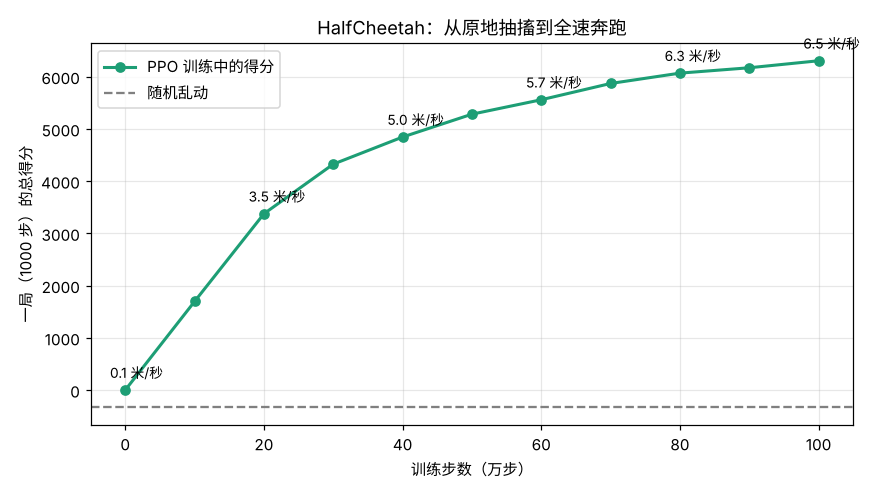
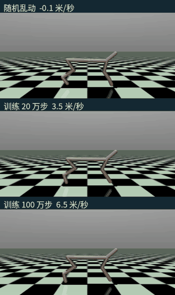

# 06 在 MuJoCo 里用 PPO 训练机器人奔跑

## 这是什么

05 的小车立杆只有 4 个状态数字、2 个动作（左推或右推）。这里换成真正的机器人仿真：

- **MuJoCo**：机器人研究最常用的物理引擎之一，算刚体、关节、接触和摩擦。
- **HalfCheetah（半只猎豹）**：一个平面上的二维机器人，有前后两条腿、6 个关节电机。它看到 17 个数（关节角度、角速度、身体速度……），每一步输出 6 个电机的力矩，都是连续值。
- **目标**：每一步的得分 ≈ 往前跑的速度 − 用力过猛的惩罚。没有人告诉它"腿该怎么摆"，步态全靠自己摸索。
- **算法**：PPO（近端策略优化），机器人强化学习最常用的算法，也是 ChatGPT 做 RLHF 时用的算法。它是 05 策略梯度的改进版：每次更新都限制策略不能变太多，训练稳定得多。这里用的是 Stable-Baselines3 的实现，超参数来自 RL Baselines3 Zoo 为 HalfCheetah 调好的配置。

## 怎么运行

```bash
pip install "gymnasium[mujoco]" stable-baselines3
python cheetah.py                  # 训练 100 万步，4 核 CPU 约 35 分钟
python cheetah.py --steps 200000   # 想快点看效果，少训一些
python cheetah.py --skip-train     # 已经训练过：只重新画图和动画
```

训练中每 10 万步存一次模型（`checkpoints/`，不放进仓库），并在固定的 5 局上测一次成绩，记进 `learning_curve.csv`。

## 文件

| 文件 | 内容 |
|---|---|
| `cheetah.py` | 训练、定期测评存档、画学习曲线、录对比动画 |
| `learning_curve.csv` | 每 10 万步的测评得分和平均速度 |
| `cheetah_curve.png` | 学习曲线 |
| `cheetah.gif` | 随机乱动、训练 20 万步、训练 100 万步的前 8 秒对比 |

## 实验结果





| 训练步数 | 得分（一局 1000 步） | 平均速度 | 训练用时 |
|---|---|---|---|
| 随机乱动 | −331 | −0.13 米/秒 | — |
| 10 万 | 1,696 | 1.75 米/秒 | 3.4 分钟 |
| 20 万 | 3,375 | 3.47 米/秒 | 6.9 分钟 |
| 50 万 | 5,282 | 5.44 米/秒 | 17.2 分钟 |
| 100 万 | 6,304 | 6.54 米/秒 | 34.7 分钟 |

（测评时不加随机探索，每次都选策略认为最好的动作。策略网络约 14 万个参数，在 4 核 CPU 上训练。）

- 前 20 万步进步最快，从原地抽搐到会跑；之后越来越慢，后 50 万步只把速度从 5.4 提到 6.5 米/秒。
- 05 里同样是策略梯度，3 个种子就有 1 个不稳定；PPO 这次训练（只跑了 1 个种子）的曲线一路平稳上升，没有崩过。区别主要在"每次只改一小步"和观察、奖励的标准化（`VecNormalize`）。
- 100 万步相当于在仿真里跑了约 14 小时（每步 0.05 秒）。真机器人不可能这样摔打，所以现实中要先在仿真里练，再迁移到真机上（Sim-to-Real），而仿真和现实的差距（摩擦、电机延迟、传感器噪声）本身就是一个大问题。
- 奖励只说"往前跑"，没说"像猎豹那样跑"。训练出的步态好不好看，取决于奖励怎么写——这就是"奖励设计"。

## 我学到了什么

<!-- 用自己的话写 -->

## 打个比方

<!-- 例如：PPO 的"每次只改一小步"像什么？ -->
