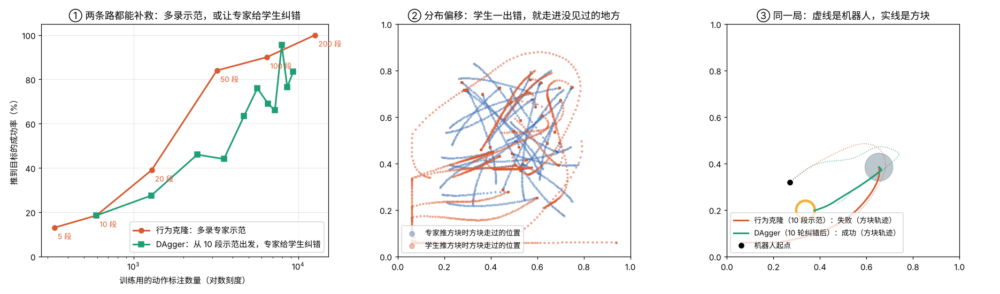
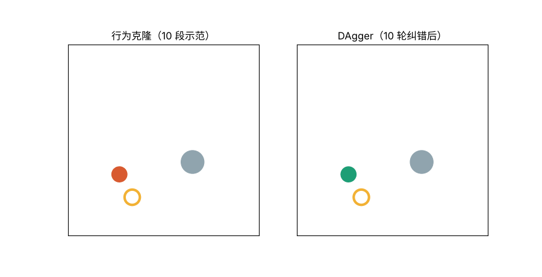

# 07 模仿学习：看专家示范，学会把方块推到目标点

## 这是什么

05 的强化学习靠奖励自己摸索，要摔几百次。另一种思路是**直接看专家怎么做，照着学**，这叫行为克隆（Behavior Cloning）。今天很多真实机器人都这样训练：人用遥控设备操纵机器人做几十上百遍，记下每一刻"看到了什么、做了什么"，再训练一个神经网络去模仿。

本项目只用 numpy：

1. **环境**：俯视的一张 1 米 × 1 米桌面，一个圆形机器人要把一个圆盘"方块"推进目标圈。机器人看到的是方块相对自己的位置、目标相对方块的位置和自己在桌上的位置，输出是移动速度。
2. **专家**：一个手写控制器，先绕到方块背后，再朝目标推，成功率 100%。相当于人类遥操作员。
3. **学生**：一个 6→64→64→2 的神经网络，用专家示范做监督学习（均方误差 + Adam，反向传播手写）。
4. **DAgger**：让学生自己推，专家在旁边告诉它"这一步本该怎么做"，把这些纠错补进训练集，再重新训练。

## 怎么运行

```bash
python push.py    # 约 1.5 分钟，生成 push_result.png 和 push.gif
```

## 文件

| 文件 | 内容 |
|---|---|
| `push.py` | 推方块环境、专家控制器、神经网络、行为克隆和 DAgger |
| `push_result.png` | 三个实验的结果图 |
| `push.gif` | 同一局：只看 10 段示范的学生和 DAgger 纠错后的学生 |

## 实验结果





成功率都在同一批 200 个随机局面上测试。

| 方法 | 训练用的动作标注数 | 成功率 |
|---|---|---|
| 行为克隆，5 段示范 | 330 | 13% |
| 行为克隆，10 段示范 | 594 | 18% |
| 行为克隆，20 段示范 | 1,287 | 39% |
| 行为克隆，50 段示范 | 3,206 | 84% |
| 行为克隆，100 段示范 | 6,451 | 90% |
| 行为克隆，200 段示范 | 12,659 | 100% |
| DAgger：10 段示范 + 4 轮纠错 | 4,691 | 64% |
| DAgger：10 段示范 + 8 轮纠错 | 7,939 | 96% |
| DAgger：10 段示范 + 10 轮纠错 | 9,336 | 84% |

- **分布偏移**：只看了 10 段示范的学生，在专家走过的状态上动作误差是 0.31，在自己推方块时走到的状态上误差是 0.51。它每一步只错一点，但错误会累积：方块一歪，就进入了专家从来没去过的局面（中图里红点贴着桌边走），而它在那里没学过，于是越错越远。
- **DAgger** 专门补这些"学生自己才会走到"的局面，从 18% 提升到 84%–96%。
- 但在这个环境里，DAgger **并没有比多录示范更省标注**：同样三千多个标注，多录示范是 84%，DAgger 是 44%。原因是每局起点都是随机的，专家示范本来就覆盖了大部分局面。DAgger 的优势在专家示范很难覆盖所有情况时才明显；它的代价也很实际：真机器人上，要人在旁边实时给每一步标注，比单纯录示范难得多。
- **专家必须"连续"**：第一版专家在方块前面时，按自己在左还是在右，决定从哪边绕。在左右分界线上，它给出的动作方向正好相反，学生学到的平均值就是"停在原地"。那一版的学生训练误差降不下去（约 0.08），DAgger 补了 6 轮纠错也一直卡在 20% 左右——它补进来的恰恰是这些自相矛盾的标注。把专家改成动作随位置平滑变化后，训练误差降到 0.005 左右，DAgger 才开始起作用。这也是近年机器人模仿学习改用扩散模型（Diffusion Policy）等能表示"多种做法"的模型的原因之一。
- DAgger 曲线有起伏（第 8 轮 96%，第 9 轮 76%），每轮都从头重新训练网络，结果对随机性比较敏感。

## 我学到了什么

<!-- 用自己的话写 -->

## 打个比方

<!-- 例如：分布偏移像什么？DAgger 像什么？ -->
